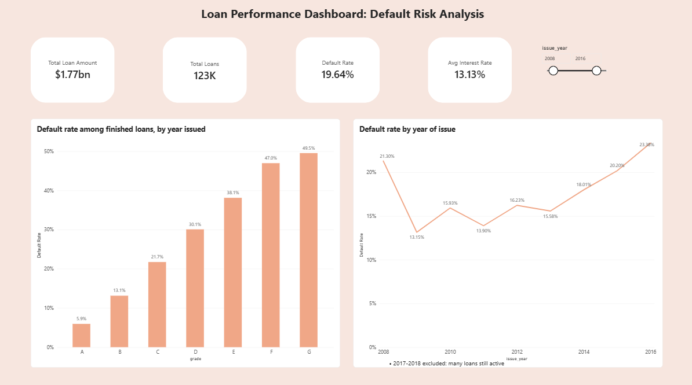
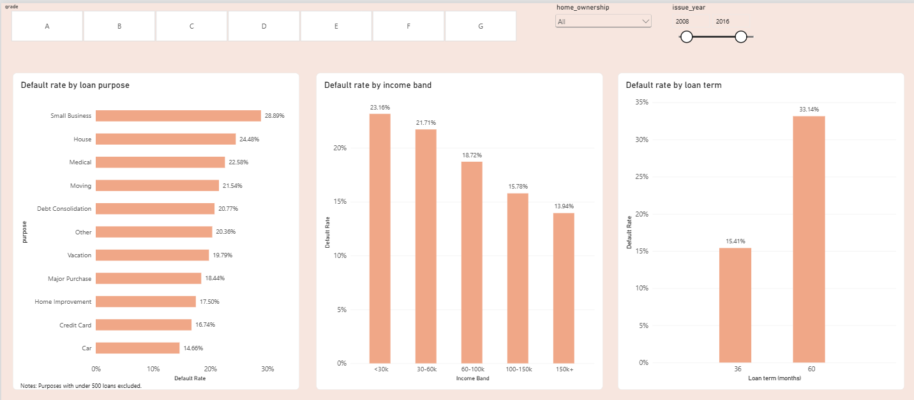
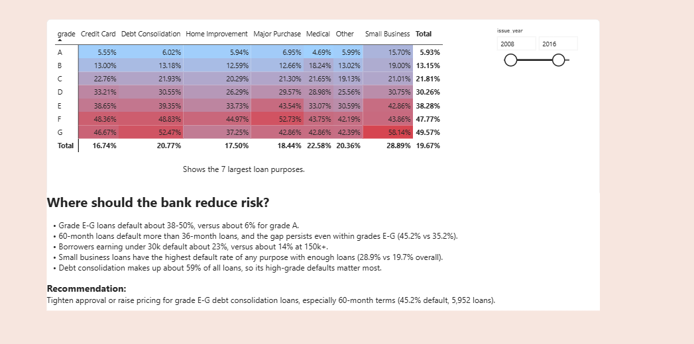

# Loan Default Risk Analysis (Python, SQL Server, Power BI)

An end-to-end analysis of ~148,000 Lending Club loans to answer one business question: **which borrowers default most, and where should a lender reduce risk?**



## Business Question

A lender wants to know which loan segments carry the most default risk, so it can tighten approval or adjust pricing where it matters most.

## Key Findings

Figures below cover loans issued 2008-2016 (about 123K loans, $1.77bn total, 19.64% overall default rate).

1. **Grade is the strongest driver of default.** Default rate rises from **5.9% (grade A)** to **49.5% (grade G)**, about 8 times higher.
2. **Longer loans default more.** 60-month loans default at **33.1%** versus **15.4%** for 36-month loans. The gap holds within high-risk grades E-G debt consolidation loans (**45.2% vs 35.2%**).
3. **Lower income, higher default.** Borrowers earning under 30k default at **23.2%**, versus **13.9%** for those earning 150k+.
4. **Small business loans are the riskiest purpose** (among purposes with at least 500 loans): **28.9%** default versus 19.6% overall.
5. **Debt consolidation is the biggest exposure.** It makes up about **59%** of all loans (72,500 of 123,491), and its grade E-G loans default at roughly 39-52%.

## Recommendation

**Tighten approval criteria or raise pricing for grade E-G debt consolidation loans, especially 60-month terms** (45.2% default across 5,952 loans). This segment is both high-risk and large, so it has the biggest impact on portfolio losses.

## Dashboard Pages

| Page | What it shows |
|------|---------------|
| Overview | KPI cards, default rate by grade, default rate by year issued |
| Who Defaults | Default rate by loan purpose, income band, and loan term, with grade, year, and home-ownership filters |
| Recommendation | Grade x purpose heatmap, key findings, and the recommendation |




## Tools and Workflow

| Step | Tool | What I did |
|------|------|-----------|
| 1. Clean | Python (pandas), Kaggle Notebooks | Loaded only the needed columns, kept finished loans (Fully Paid / Charged Off), created a default flag, fixed data types, removed outliers, added income and loan-size bands |
| 2. Query | SQL Server Express, SSMS | Imported the clean data into a local database and wrote queries to analyse default rate by grade, purpose, income, term, and year |
| 3. Visualise | Power BI Desktop | Built DAX measures (Total Loans, Default Rate, Avg Interest Rate) and a 3-page dashboard with filters |
| 4. Share | GitHub | Notebook, SQL scripts, dashboard file, and screenshots |

## Data

- **Source:** Lending Club accepted loans, 2007-2018 (public dataset on Kaggle).(https://www.kaggle.com/datasets/jsganesh/accepted-2007-to-2018q4-csv)
- **Prepared sample:** 150,000 randomly sampled finished loans, reduced to **148,273** rows after removing missing values and outliers.
- **Definition:** a loan counts as a default if its status is *Charged Off*; *Fully Paid* counts as non-default.

## Limitations

- **Only finished loans are included.** Loans still being repaid are excluded, so recent years can look riskier than they really are. I limited the dashboard to 2008-2016 for this reason, but 2015-2016 may still be slightly overstated.
- **Results show patterns, not causes.** Grade, income, and term are linked (for example, lower-income borrowers tend to get lower grades), so these findings do not prove that any one factor causes default.
- **Small segments are excluded.** Purposes with fewer than 500 loans (Educational, Renewable Energy, Wedding) are left out because their rates are not reliable.
- **Public data from one lender.** Results may not apply to other lenders or markets.

## Repository Contents

```
loan-default-analysis/
├── README.md
├── loan_data_cleaning.ipynb    # data cleaning in Python
├── loan_analysis.sql           # SQL queries used for analysis
├── loan_dashboard.pbix         # Power BI dashboard
└── screenshots/                # dashboard page images
```

## How to Reproduce

1. Download the Lending Club dataset from Kaggle (link above).
2. Run `loan_data_cleaning.ipynb` to create `loans_clean.csv`.
3. Import the CSV into SQL Server (table name `loans`) and run `loan_analysis.sql`.
4. Open `loan_dashboard.pbix` in Power BI Desktop and point the data source to your local database.

## About

Built by Insyirah as a portfolio project. 